<p align="center">
  
</p>

<h1 align="center">CryptoPay</h1>

<p align="center">
  <strong>Accept crypto payments on your own server.</strong><br>
  A self-hosted, non-custodial payment gateway for USDT, USDC, BTC, ETH and more.<br>
  Funds go straight from your customer's wallet to yours — the gateway never holds a private key.
</p>

<p align="center">
  <a href="docs/getting-started.md">Getting started</a> ·
  <a href="docs/integration.md">Integration guide</a> ·
  <a href="docs/api.md">API reference</a> ·
  <a href="docs/architecture.md">Architecture</a>
</p>

> [!WARNING]
> Cryptocurrency payments are irreversible. **Test everything yourself before you accept real funds**, and read the [disclaimer](#disclaimer): the software is provided as is, and any loss of funds is your responsibility, not the author's.

<p align="center">
  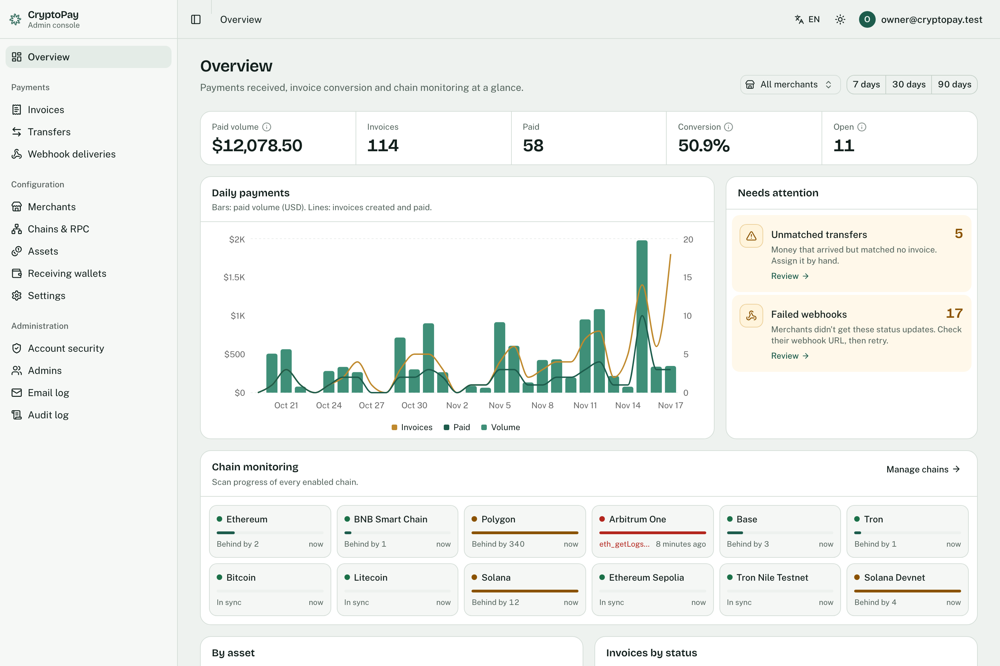
</p>

## Why CryptoPay

- **Non-custodial by design.** The server only knows an extended **public** key (xpub), or a single static address. Every invoice gets a fresh receiving address, and pasting a private key into the console is rejected.
- **The coins customers actually pay with.** Stablecoins (USDT — mostly on Tron — USDC, PYUSD) plus BTC, ETH, LTC, TRX, SOL and BNB, across nine mainnets and four testnets. Custom ERC-20 / TRC-20 / SPL tokens can be added from the console.
- **Pay with a wallet or a QR code.** One click with a browser wallet (MetaMask, TronLink, UniSat, OKX…), or scan a payment-request QR code from a phone wallet. The checkout works on small screens.
- **It copes with real-world payments.** Partial payments, overpayments, a configurable underpayment tolerance, late payments inside a grace period, and chain reorganisations are all handled and reported.
- **Webhooks you can trust.** Signed with HMAC-SHA256, retried with exponential backoff, delivered at least once with a stable event id. Creating an invoice is idempotent on `order_id`.
- **Built for several merchants.** Separate API keys and webhook secrets per merchant, optional per-merchant receiving wallets, and a per-merchant overview.
- **A real admin console.** Chains and RPC endpoints, wallets, invoices, on-chain transfers, webhook deliveries, an audit log, three roles, two-step verification with recovery codes, session management and email alerts. English and Chinese.
- **Your RPC, your choice.** Use a commercial RPC (Alchemy, Infura, QuickNode, TronGrid, Helius, your own node…) configured in the console and stored encrypted; free public nodes are the default for development.
- **Made to be tested.** The whole backend and frontend test suite runs in Docker with `make test`.

## See it in action

### What your customer sees

<table>
  <tr>
    <td align="center">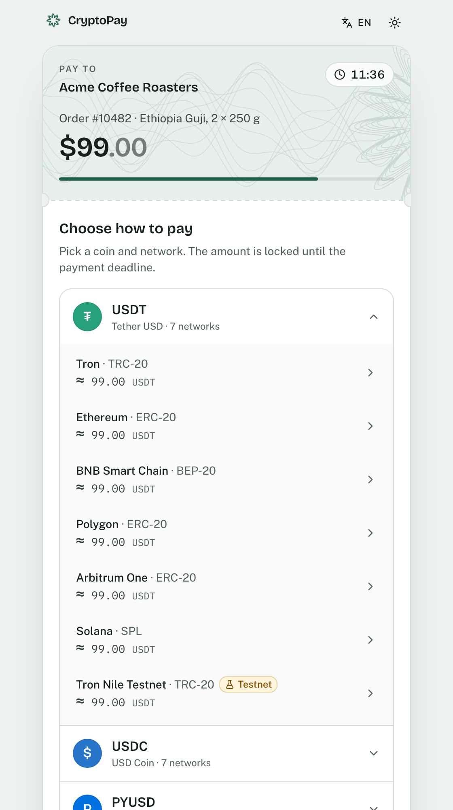</td>
    <td align="center">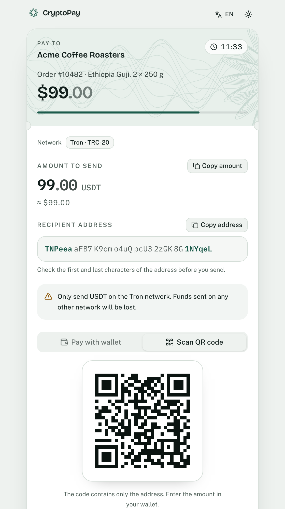</td>
    <td align="center">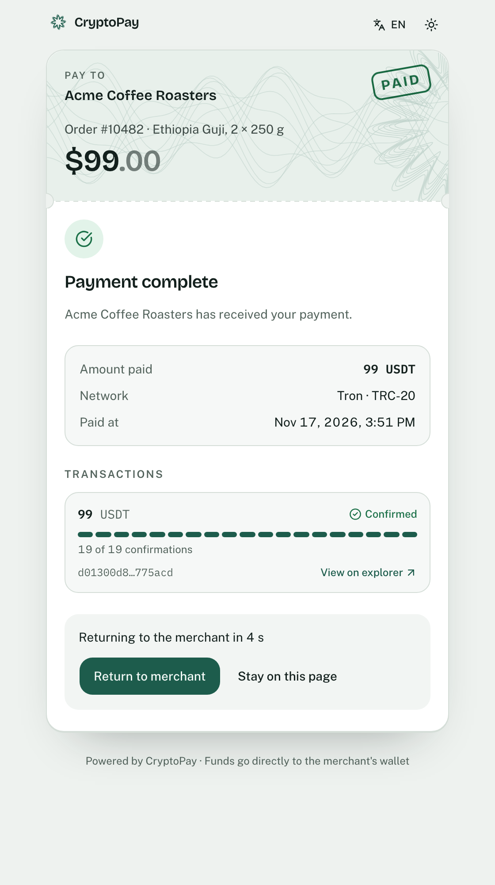</td>
  </tr>
  <tr>
    <td align="center"><sub>Pick a coin and network</sub></td>
    <td align="center"><sub>Send the exact amount</sub></td>
    <td align="center"><sub>Payment confirmed</sub></td>
  </tr>
</table>

<p align="center">
  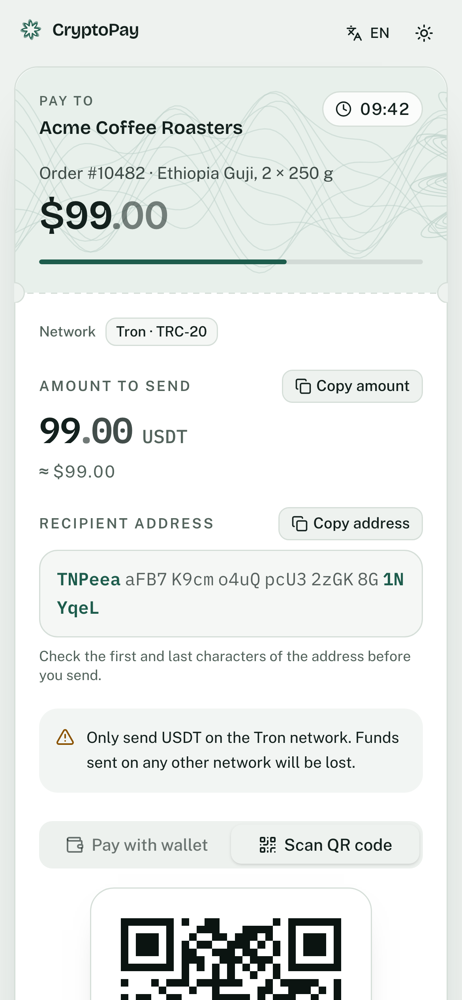<br>
  <sub>The same checkout on a phone.</sub>
</p>

### What you see

<p align="center">
  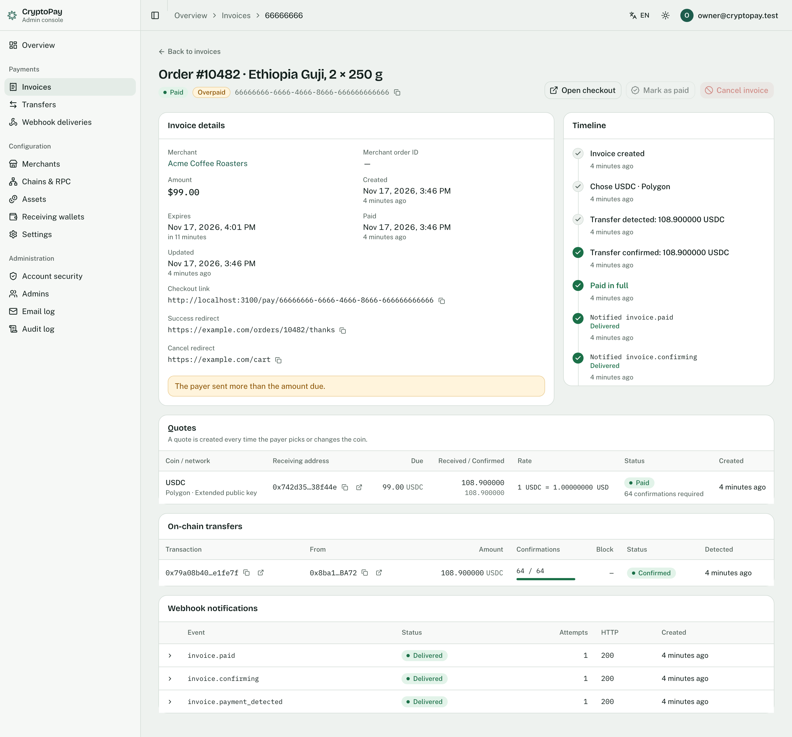<br>
  <sub>Every invoice, with its timeline, quotes, on-chain transfers and webhook deliveries.</sub>
</p>

<p align="center">
  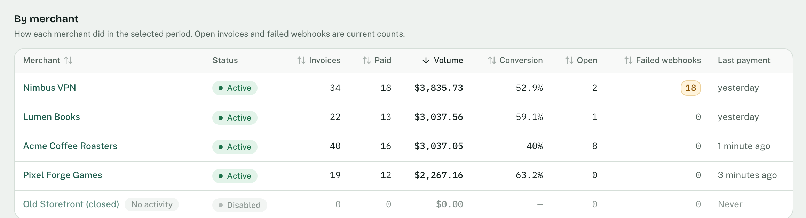<br>
  <sub>Compare merchants side by side — volume, conversion, open invoices and failing webhooks.</sub>
</p>

<table>
  <tr>
    <td align="center">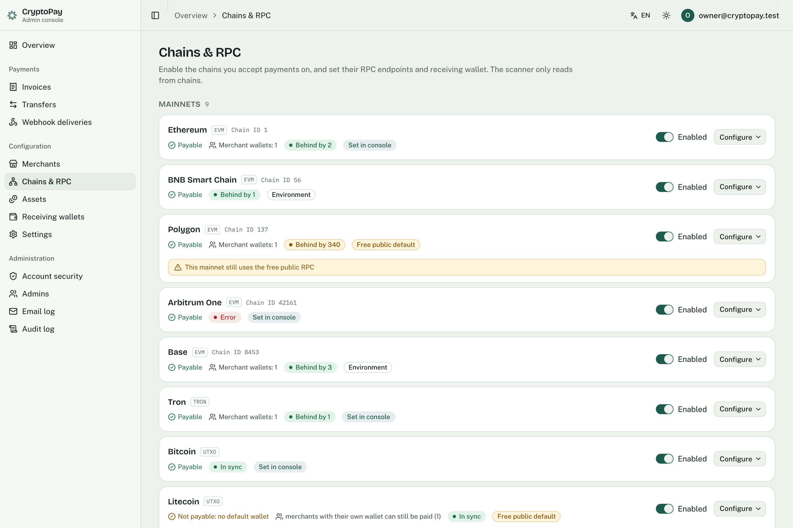</td>
    <td align="center">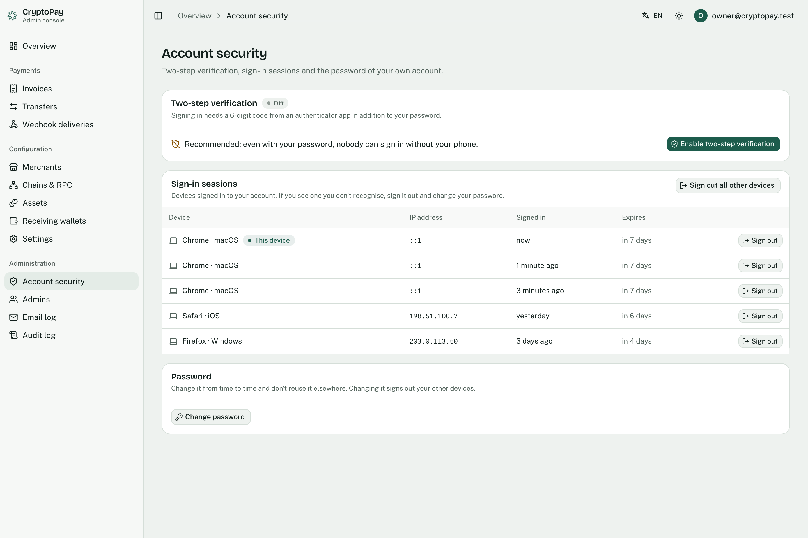</td>
  </tr>
  <tr>
    <td align="center"><sub>Chains, RPC endpoints and scan progress</sub></td>
    <td align="center"><sub>Two-step verification and sign-in sessions</sub></td>
  </tr>
</table>

## How it works

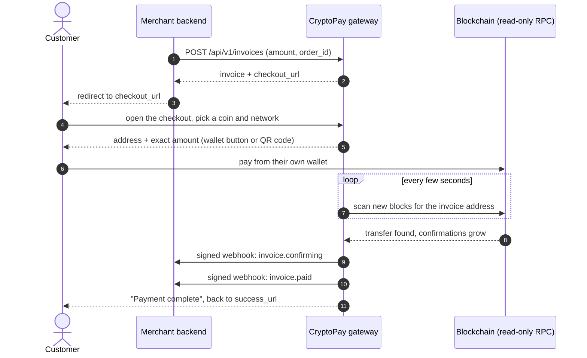

The gateway only **reads** the chain. It never signs or broadcasts a transaction, so there is nothing on the server worth stealing.

## Supported coins and networks

Stablecoins account for roughly **60%** of crypto payment volume (led by USDT, most of it on Tron, followed by USDC). Among native coins, BTC, LTC, ETH and TRX are used most across payment processors (CoinGate / CoinsBee / NOWPayments statistics for 2025–2026). The built-in catalog follows that:

| Family | Network | Assets | Default confirmations |
|---|---|---|---|
| EVM | Ethereum | ETH, USDT, USDC, PYUSD | 12 |
| EVM | BNB Smart Chain | BNB, USDT, USDC | 15 |
| EVM | Polygon | USDT, USDC | 64 |
| EVM | Arbitrum One | ETH, USDT, USDC, PYUSD | 40 |
| EVM | Base | ETH, USDC | 20 |
| Tron | Tron | TRX, USDT | 19 |
| UTXO | Bitcoin | BTC | 2 |
| UTXO | Litecoin | LTC | 6 |
| Solana | Solana | SOL, USDT, USDC, PYUSD | finalized |
| Testnets | Sepolia · Tron Nile · Bitcoin Testnet · Solana Devnet | ETH/USDC/PYUSD · TRX/USDT · BTC · SOL/USDC/PYUSD | — |

Mainnets are enabled by default and testnets are disabled. A chain can take payments once it has a receiving wallet.

## Invoice lifecycle

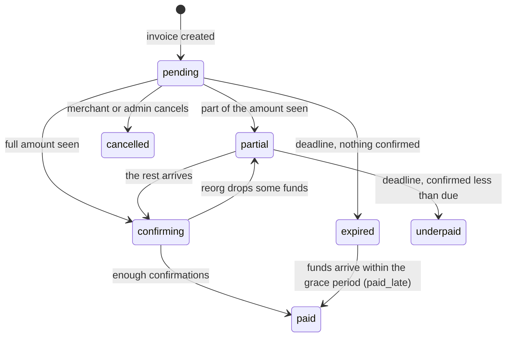

Every status change becomes one webhook event, written in the same database transaction as the change itself. "Paid" means the confirmed amount reached the amount due minus the configured tolerance; paying more than due is flagged as `overpaid`.

## Where the money goes

Each merchant can be paid into their own wallet, into a shared chain-wide default wallet, or both on different chains.

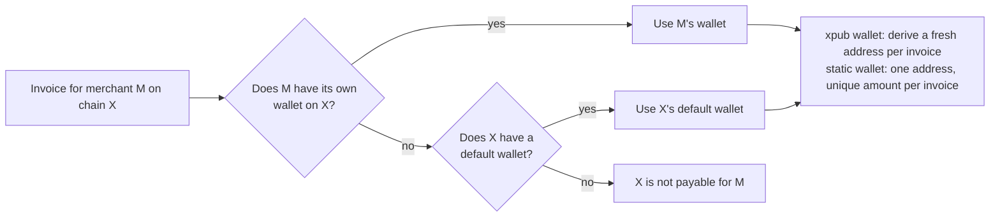

## Architecture

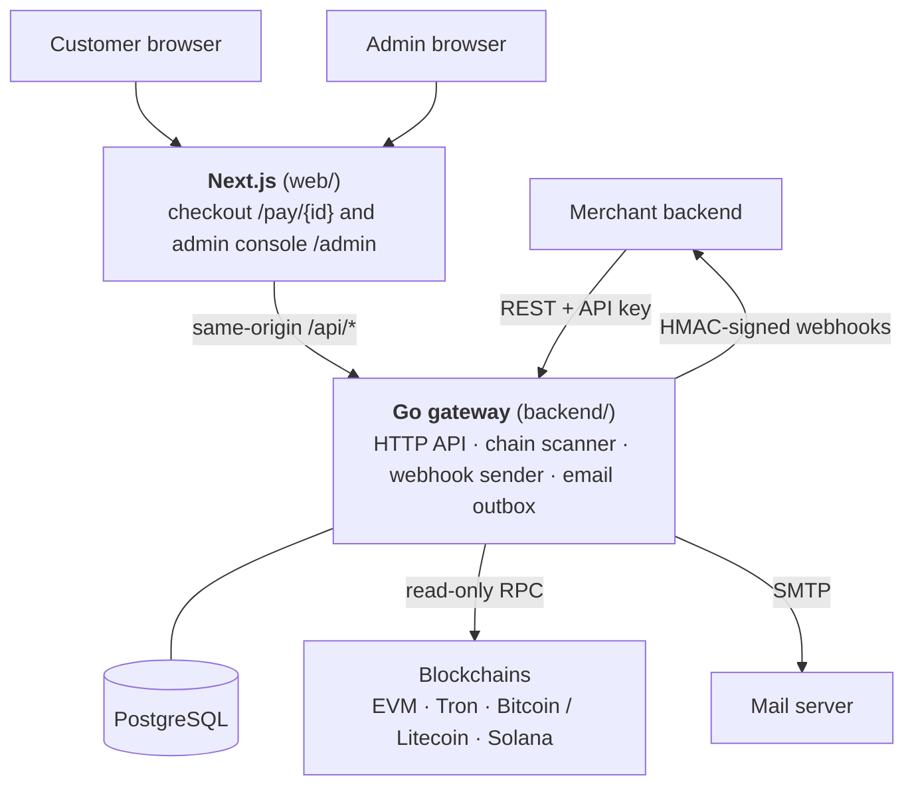

The browser only talks to Next.js (same origin); Next.js proxies `/api/*` to the Go backend. Read [docs/architecture.md](docs/architecture.md) for the details.

## Quick start

You need Docker with Compose v2.

```bash
cp .env.example .env
# Edit .env: at the very least change APP_SECRET (openssl rand -base64 48) and ADMIN_PASSWORD
docker compose up --build -d        # or: make up
docker compose ps                   # wait until backend shows healthy
```

Open the admin console at http://localhost:3000/admin and sign in with the `ADMIN_EMAIL` / `ADMIN_PASSWORD` from `.env`. To try it with demo data on test networks, run `make seed-dev` and follow the [testnet walkthrough](docs/testnet-walkthrough.md).

Then [create a receiving wallet, set up your RPC endpoints and add a merchant](docs/getting-started.md#first-run-set-up-the-admin-console).

## Integrate in minutes

Create an invoice from your backend, send the customer to `checkout_url`, and wait for the `invoice.paid` webhook:

```bash
curl -X POST https://pay.example.com/api/v1/invoices \
  -H "Authorization: Bearer sk_live_xxx" \
  -H "Content-Type: application/json" \
  -d '{
        "amount": "25.00",
        "currency": "USD",
        "order_id": "ORDER-1001",
        "success_url": "https://shop.example/thanks"
      }'
```

Webhooks carry an `X-CryptoPay-Signature` header, `hex(HMAC-SHA256(secret, timestamp + "." + raw body))`. Verify it, deduplicate on the event `id`, and only ship the goods on `invoice.paid`. The [integration guide](docs/integration.md) has a complete Go example and the retry semantics.

## Documentation

| Guide | What is in it |
|---|---|
| [Getting started](docs/getting-started.md) | Run it with Docker, demo data, first-run setup of wallets, RPC, merchants |
| [Integration guide](docs/integration.md) | Create invoices, redirect the customer, verify webhooks |
| [API reference](docs/api.md) | The HTTP contract for the checkout, merchant and admin APIs |
| [Configuration](docs/configuration.md) | Environment variables and `gateway` commands |
| [Admin account security](docs/admin-security.md) | Two-step verification, sessions, email notifications, break-glass recovery |
| [Security and production](docs/production.md) | Security model, production checklist, known limitations |
| [Architecture](docs/architecture.md) | Packages, receiving wallets, scanner, webhooks |
| [Testnet walkthrough](docs/testnet-walkthrough.md) | Pay a real invoice on Sepolia, Tron Nile and Bitcoin testnet |
| [Development and tests](docs/development.md) | Running the test suites in Docker |

## Security at a glance

- **Non-custodial and read-only.** Only extended public keys or static addresses are stored, only read-only RPC methods are called, and nothing is ever signed. Sweeping funds is done in your own wallet software.
- **Secrets at rest.** RPC URLs and webhook signing secrets are encrypted with `APP_SECRET`; API keys and session tokens are stored only as SHA-256 hashes.
- **A hardened console.** HttpOnly sessions, CSRF protection, rate-limited sign-in, optional or enforced TOTP two-step verification, three roles, and an audit log of every change.

Before going live, work through the [production checklist](docs/production.md#production-checklist) and read the [known limitations](docs/production.md#known-limitations).

## Tech stack

Go (HTTP API, chain scanners, webhook delivery) · Next.js 16, React 19, Tailwind CSS and shadcn/ui (checkout and console) · PostgreSQL · Docker Compose. The repository layout is described in [docs/architecture.md](docs/architecture.md); run the tests with `make test`.

## Disclaimer

CryptoPay is provided **"as is", without warranty of any kind**, as stated in the [MIT License](LICENSE). Payments in cryptocurrency cannot be reversed, and software that handles them can contain defects.

- **You are responsible for testing.** Before you accept real funds, test your whole setup yourself: run the test suites (`make test`), then walk through your own flows on testnets and with small mainnet amounts. Check that the addresses derived from your extended public key match your wallet, that every chain and asset you enable is detected, that your server verifies webhook signatures and handles duplicates, and that partial, late and overpaid invoices end up the way you expect. Review the code you deploy, your configuration and the RPC and price providers you rely on.
- **Any loss of funds is not the author's responsibility.** The author and contributors accept no liability for any loss or damage, including payments that are lost, misdirected, undetected, mispriced or credited twice, wrong invoice states, missed or duplicated webhooks, lost or leaked keys and secrets, outages or errors of third-party RPC, price or e-mail providers, and security incidents. This applies whether the cause is a defect in CryptoPay, your configuration or deployment, or a third party. Everything you do with this software is at your own risk.
- **Custody stays with you.** The gateway never holds a private key, so it cannot recover, move or refund funds. Keeping the wallet seed and `APP_SECRET` safe and backed up is your job.
- **Not advice, and not a compliance tool.** Nothing here is financial, legal or tax advice. Licensing, KYC / AML, sanctions and tax rules that apply to accepting crypto payments are your responsibility as the operator.

See also the [known limitations](docs/production.md#known-limitations).

## License

[MIT](LICENSE) © GanymedeNil
